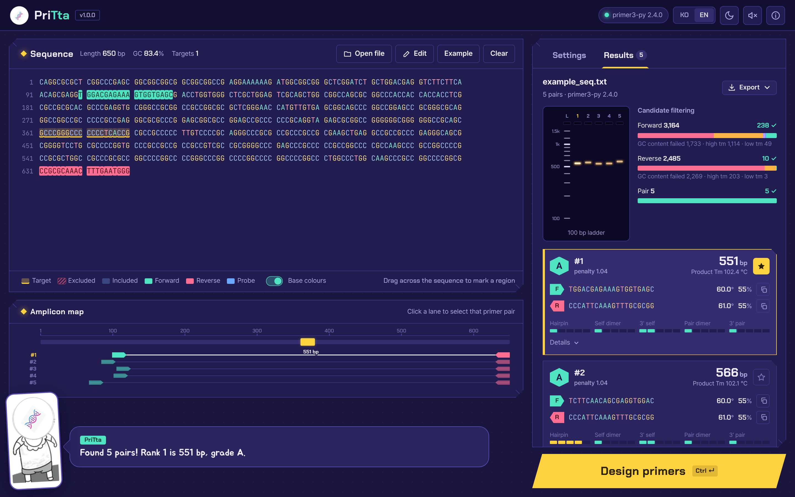

<p align="center">
  
</p>

<h1 align="center">PriTta</h1>

<p align="center">
  <b>Primer + 뜌땨</b> · a game-style desktop app for Primer3 PCR primer design<br>
  <i>"뜌따.. 뜌우따이 뜌따따 우따야!"</i>
</p>

<p align="center">
  <b>English</b> | <a href="README.ko.md">한국어</a>
</p>

<p align="center">
  
  
  
  
</p>



## What is PriTta?

**PriTta** (pronounced *pree-tta*) is **Pri**mer + **뜌땨** (*dyuttya*), the sound our
mascot makes. It only ever says one thing: *"뜌따.. 뜌우따이 뜌따따 우따야!"*, but it
designs good primers.

PriTta is a desktop app built on [Primer3](https://github.com/primer3-org/primer3).
Paste a sequence, mark the target with `[ ]`, and press **Design primers**. You get:

- ranked primer pairs with S–D grades
- hairpin and dimer checks
- an amplicon map and an expected gel

Results export as an oligo order sheet, a table, or Primer3's own
`.primer3.in` / `.primer3.out` files.

Primer3 ships inside the app through [primer3-py](https://github.com/libnano/primer3-py),
so you don't need WSL or a separate `primer3_core` build. The **Standard PCR** preset
reproduces the classic `primer3.sh` workflow byte for byte (verified in `tests/`).

## Quick start (Windows)

1. Download **`PriTta.exe`** from [Releases](../../releases).
2. Double-click it. Nothing to install.
3. Click **Example**, then **Design primers**.

The first launch takes a few seconds while the single-file app unpacks. The exe is not
code-signed, so Windows SmartScreen may warn about an unrecognized app. Choose
**More info → Run anyway**. PriTta uses Microsoft Edge WebView2, which comes with
Windows 10/11; on older PCs install the
[WebView2 Runtime](https://developer.microsoft.com/microsoft-edge/webview2/) first.

## Features

| | |
|---|---|
| **Sequence input** | Plain text, FASTA (one or many records) or Boulder-IO files. Drag and drop, open a file, or paste anywhere with Ctrl+V. Note lines pasted along with the sequence (gene name, HGVS, coordinates) are ignored with a warning. |
| **Regions** | `[target]`, `<excluded>`, `{included}`, the same syntax as Primer3Web. You can also drag across the sequence and pick Target / Exclude / Include. |
| **Presets** | Standard PCR (same as `primer3.sh`), qPCR (SYBR), qPCR + TaqMan probe, Sanger sequencing. Every Primer3 parameter stays editable. |
| **Results** | S/A/B/C/D grades, colour-coded primers with one-click copy, hairpin/dimer risk bars, ASCII secondary structures, a virtual gel against a 100 bp ladder, and bars that show why candidates were rejected. |
| **Batch** | Load a multi-FASTA and design every record in one run. |
| **Export** | Oligo order sheet (starred pairs), CSV/TSV table, `.primer3.in`, `.primer3.out`. Opening an old `.primer3.out` shows its results without re-running. |
| **Mascot** | Spins its DNA head while Primer3 works, jumps on success, sulks on failure, and gives tips when clicked. |
| **Comfort** | Korean/English interface, light/dark themes, optional sound effects (off by default). |

## How to use

1. **Add a sequence** and mark the region the PCR product must contain:

   ```text
   ...GGCCGCAGC[GCCCGGGCCCCCCCTCACCG]CGCCGCCCCC...
   ```

   | Markup | Meaning | Primer3 tag |
   |---|---|---|
   | `[ ... ]` | target: the product must span it | `SEQUENCE_TARGET` |
   | `< ... >` | excluded: no primer may overlap it (SNPs, repeats) | `SEQUENCE_EXCLUDED_REGION` |
   | `{ ... }` | included: primers must lie inside it | `SEQUENCE_INCLUDED_REGION` |

2. **Pick a preset** in Settings and adjust product size, Tm, GC and so on if needed.
3. **Press Design primers** (or Ctrl+Enter).
4. **Review and export.** Click a card or a map lane to highlight that pair in the
   sequence, star the pairs you want, then choose **Export → Oligo order sheet**.

### Checking specificity on NCBI Primer-BLAST

When you paste the forward and reverse primers into
[Primer-BLAST](https://www.ncbi.nlm.nih.gov/tools/primer-blast/) without a template,
set **Database** to **RefSeq Representative genomes** (organism *Homo sapiens*) for
primers designed on genomic DNA. With the default *RefSeq mRNA*, primers in introns
or flanking an exon find no template, so nothing shows up.

### Grades

Grades follow the Primer3 pair penalty, where 0 means every parameter is at its optimum:
**S** ≤ 0.5 · **A** ≤ 1.5 · **B** ≤ 3 · **C** ≤ 6 · **D** > 6.

The five risk bars on each card compare the thermodynamic Tm of hairpins and dimers
with the limits in Settings (default 47 °C). One bar means far from the limit, and five
means at or over it.

### Coordinates

Positions shown in the app and in exported tables are **1-based**. The raw
`.primer3.in` / `.primer3.out` files keep Primer3's **0-based** coordinates, exactly as
`primer3_core` writes them.

## Command line

`pritta-cli` is a cross-platform replacement for `primer3.sh`:

```bash
pritta-cli example_seq.txt ex_example           # -> ex_example.primer3.in / .primer3.out
pritta-cli targets.fa run1 --preset qpcr --csv   # + run1.primers.csv, run1.order.tsv
pritta-cli seq.txt out --set PRIMER_PRODUCT_SIZE_RANGE=200-400 --set PRIMER_NUM_RETURN=10
```

Windows releases include `pritta-cli.exe`. From source, use `python -m pritta.cli`.

PriTta uses `primer3-py` by default. To use your own `primer3_core` build instead,
PriTta looks for it in `$PRIMER3_BIN`, then `~/tool/primer3/src/primer3_core`, then
`PATH`. Select it under Settings → Advanced → Engine, or pass `--engine primer3_core`.

## Run from source

```bash
git clone https://github.com/CleanCham-lab/PriTta.git
cd PriTta
pip install -r requirements.txt
python -m pritta              # desktop window (Windows/macOS; Linux with GTK or Qt)
python -m pritta --browser    # open in a web browser
```

On WSL, PriTta opens in your Windows browser automatically.

## Build the Windows app

- **Locally:** double-click `build_windows.bat` (needs Python for Windows). It leaves
  `PriTta.exe` and `pritta-cli.exe` next to it.
- **Manually:** `pip install -r requirements.txt pyinstaller`, then
  `pyinstaller --noconfirm --clean PriTta.spec`.

## Project layout

```text
pritta/
  sequence.py   sequence + [ ] < > { } parsing, FASTA, Boulder-IO input
  params.py     Primer3 parameters, defaults and presets
  engine.py     runs Primer3, normalizes results, writes .primer3.in/.out
  export.py     CSV/TSV tables and oligo order sheets
  api.py        bridge called by the interface
  app.py        desktop window (pywebview) / browser mode
  cli.py        command line
  web/          interface (HTML/CSS/JS), mascot, icons, fonts
tests/          pytest suite, including byte-for-byte parity with primer3.sh
icon/           original PriTta artwork
```

## Citation

If PriTta helps your work, please cite Primer3:

> Untergasser A, Cutcutache I, Koressaar T, Ye J, Faircloth BC, Remm M, Rozen SG.
> Primer3 — new capabilities and interfaces. *Nucleic Acids Research* 2012;40(15):e115.

## License

PriTta's source code is released under the [MIT License](LICENSE).

- The Windows build bundles Primer3 / primer3-py (GPL-2.0-or-later), so that bundled
  binary is distributed under GPL terms.
- Fonts are SIL OFL 1.1.
- The mascot and icon images are not covered by the MIT License.

See [THIRD_PARTY_NOTICES.md](THIRD_PARTY_NOTICES.md) for details.

## Credits

Developed by **Seung Won Chae**: Molecular Diagnostics Laboratory, Department of
Laboratory Medicine, Seoul National University Hospital, and Seoul National University
Cancer Research Institute.
